# Holographic Hullabaloo
A spinning LED (Persistence of Vision) desk assistant which creates a "holographic" sarcastic 3D desk buddy.

<p align="center">
  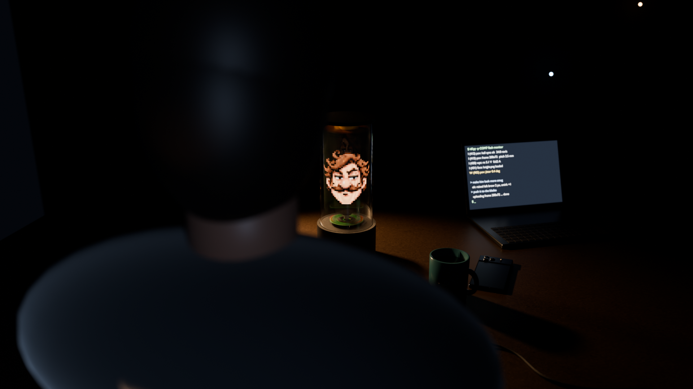
</p>

### what is he talking about?

I understand your possibly dire confusion, so I'll try my best to explain it in the simplest way possible. Have you ever seen those LED fans which are all over Insta? They spin, to create an image.

The problem, however with those, is that they can only be viewed from one side, and properly from only one angle. Instead of engineering the solution, they are simply stuck on your wall, so it is only possible to view it from that exact point. Sometimes the best solutions are the most simple ones. Not in this case.

From this failure of a potential innovation sprouted a not very original, but a not-widely-done idea of an LED fan, but 3D, with AI integration, and sarcasm.

One may ask, why on earth would he do such a thing which would force him to spend hours upon hours coding and tuning the expression sequence loop? The short answer is, I'm speedrunning carpal tunnel. The long answer is that it would usually annoy me when those viral fans would call themselves high-tech, and 3d image viewer, and stuff like that, and nearly everyone who would buy them would end up disappointed. Or with their hand chopped off. But I built this mostly because it would look cool on my desk. (i hope u know im kidding)

$\color{orange}{\textsf{3D image + offline AI + Sass = Holographic Hullabaloo}}$
### how does it work?
2 blades with each a singular column of 72 LEDs, directly opposite each other, spin around a pivot at 1500 RPM, driven by a 775 motor, and rapidly flash in a coded sequence to create an image of a floating 3D face, which expresses and talks to you by recording your voice through the mic in the base, sending the audio through a USB cable to the laptop, where it gets transcribed and answered by a local Ollama-routed Gemma 3:4b, and then sending the answer back so the device speaks to you. Each response comes with an emotion tag, which tells the onboard ESP which expression to change to.

### how do I use it?
1. Plug in the 12V adapter to a wallsocket.
2. Connect the USB-C to the laptop. It should be recognized as a sound card.
3. Start the desktop app (Windows only, yet to be built)
4. Walk up to it and use the push-to-talk button (Wakeword will be toggleable)
5. When it senses that no one is around, it will stop spinning on its own in 10 minutes.

<details>
<summary>specs table</summary>

| Spec | Value |
| --- | --- |
| Display | Cylindrical POV, 100 mm across, 180 mm tall |
| Blades | 2, opposite each other at 50 mm radius |
| LEDs | 72 x APA102-2020 per blade (144 total), 2.5 mm pitch |
| Resolution | 72 rows x 200 columns per spin |
| Pixel size | 2.5 mm tall x 1.57 mm wide |
| Speed | 25 rev/s (1500 RPM) |
| Refresh | 50 Hz (2 blades) |
| Column time | 200 us |
| LED data | 4 parallel chains of 36, ESP32-S3 LCD peripheral, 12 MHz clock |
| Frame size | 43 KB (72 x 200 x 3 bytes), double buffered |
| Angle sensing | DRV5023 Hall sensor at 35 mm radius + 6 x 3 mm neodymium magnet, about 7.5 mm gap, about 19 mT at the sensor |
| Rotor MCU | ESP32-S3-WROOM-1-N8 (hub PCB) |
| Base MCU | ESP32-S3-WROOM-1-N8 (base PCB) |
| Rotor power | Wireless coil pair (12 V in, 5 V out, 43 mm coils, 3 mm gap) + 1S 1500 mAh LiPo backup |
| Rotor power chain | BQ24073 power-path charger (4.4 V out) -> TPS61088 boost (5.04 V) -> AMS1117 (3.3 V) |
| Rotor power draw | about 4 W typical, 5.2 W peak at 5 V (LED current capped at 0.8 A in firmware) |
| Base power | 12 V 3 A adapter -> MP1584 buck (5.0 V) through an SS34 diode, 470 uF bulk cap on 12 V for motor start |
| Motor | 12 V brushed 775, PI speed loop, hard cap about 28 rev/s |
| Audio | 40 mm 4 ohm 3 W speaker (MAX98357A, I2S) + INMP441 I2S mic |
| Laptop link | One USB-C cable: USB sound card + serial (native USB on the base ESP32-S3) |
| Base to rotor link | ESP-NOW, encrypted, MAC filtered, about 65 ms worst-case latency |
| AI | faster-whisper (speech to text), Gemma 3 4B via Ollama, Piper (text to speech), all local |
| Rotor frame | 2 x 104 x 30 x 3 mm aluminium bars, 2 x 10 x 10 x 1 mm angle posts, 4 L brackets |
| Cover | Rolled 1 mm polycarbonate, 125 mm across, 252 mm tall |
| Rotor mass | about 123 g |
| Blade force at speed | about 126 g, about 18 N per blade |
| Tip speed | about 7.9 m/s |
| Base | PETG, 140 mm across, 90 mm tall, removable floor |

</details>

<details>
<summary>CAD</summary>

Onshape (public): https://cad.onshape.com/documents/4085c279545975c6c33be840/w/43f94851c94c60cadccb3d5d/e/8ae002254131cced06da6b73

STEP files: [`cad/step/`](cad/step/)


| Module | What it is | STEP |
| --- | --- | --- |
| A | Rotor frame: 2 aluminium bars (104 x 30 x 3 mm), 2 angle posts, 4 L brackets | `A_frame_assembly_v3.step`, `A1_bottom_bar.step`, `A2_top_bar.step`, `A3_post.step`, `A4_bracket.step` |
| B | Blade PCB (190 mm, 72 LEDs) | `B1_Blade_v3_onshape.step` |
| C | Hub PCB placeholder (ESP32, coil, Hall, headers, USB-C on the flat edge) | `C_hub_placeholder.step` |
| D | Drive stack: 775 motor, flange coupling, coil pair, standoffs | `D_drive_stack.step` |
| E | Base v3: shell, removable floor, base PCB, speaker, mic | `E_base_v3_assembly.step`, `E1_base_shell_v3.step`, `E2_floor_plate.step`, `E3_base_pcb.step`, `E4_speaker_40mm.step`, `E5_INMP441_mic.step` |
| F | LiPo + polycarbonate cover + cap | `F_battery_cover.step` |
| All | Full assembly (34 parts) | `Fallen_full_assembly.step` |

| Fastener | Where |
| --- | --- |
| M2 x 6 | Blade PCB to angle post |
| M3 x 6 | L bracket to post |
| M3 x 8 | L bracket to bar, floor plate to base |
| M3 x 10 | Flange coupling to bottom bar |

| Integration check | Result |
| --- | --- |
| Interference check | 0 clashes across all 34 parts |
| Rotor centre of mass | 0.53 mm off axis, trimmed with about 2 g at r 35 mm |
| Cover clearance | 8.6 mm radial, 6.8 mm to the cap |
| Hall sensor vs magnet | r 34.5 mm vs r 35 mm |
| Coil gap | 3 mm |
| Motor shaft in coupling | 6.3 mm (13.5 mm standoffs) |
| Base board to motor | 13 mm clear |
| 470 uF cap to motor | 2.5 mm clear |
| DC jack to speaker connector | 9 mm clear |

</details>

<details>
<summary>cool blender renders</summary>

<p align="center">
  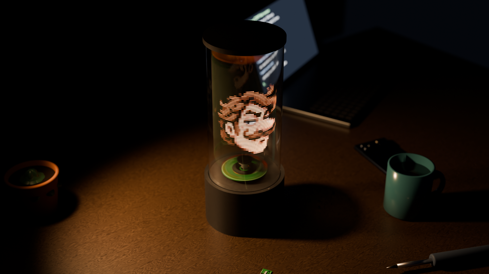
  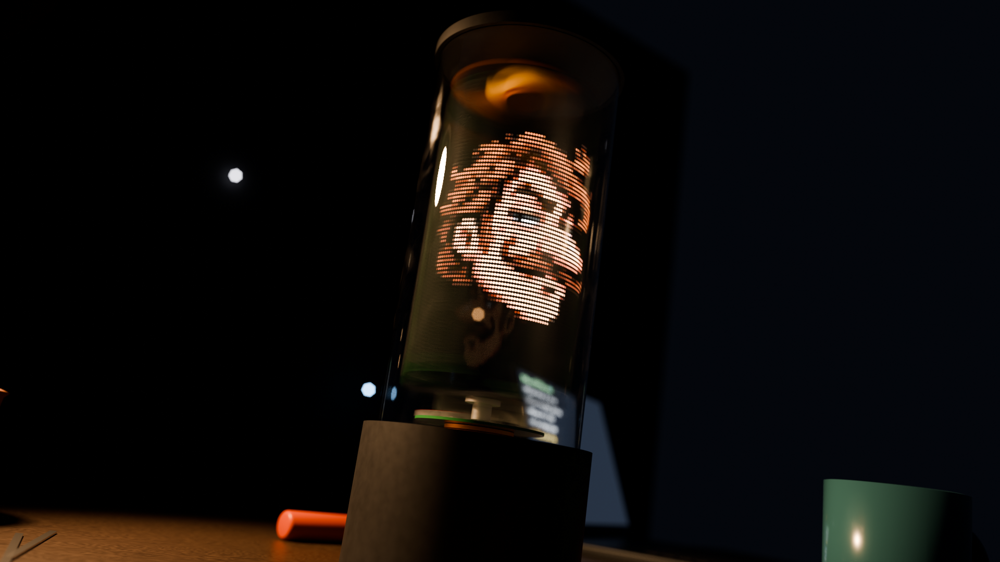
  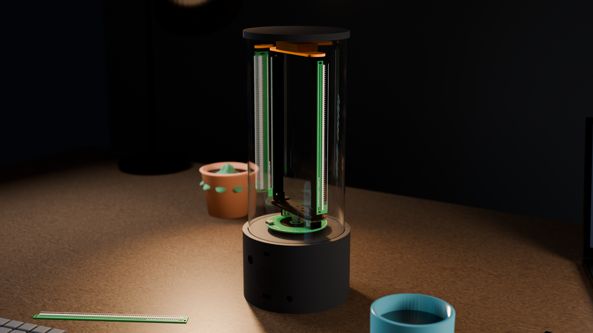
  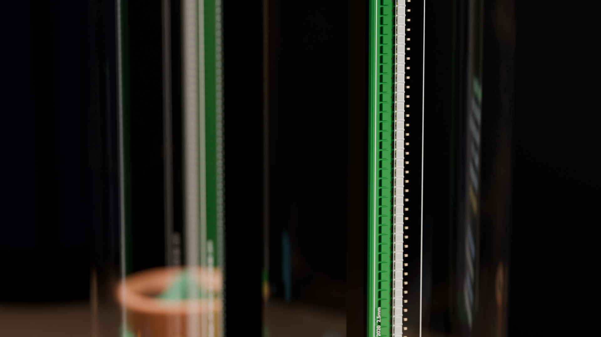
</p>


</details>

<details>
<summary>PCBs</summary>

| Board | Layers | Size | What's on it | Files |
| --- | --- | --- | --- | --- |
| Hub (rotor) | 2 | 80 mm disc with a flat edge for the USB-C, 12 mm centre hole | ESP32-S3, BQ24073 charger, TPS61088 boost, AMS1117, AO3401A switches, 74AHCT245 LED buffer, DRV5023 Hall, USB-C, RX coil header, LiPo JST | [`pcb/hub`](pcb/hub) |
| Blade (x2) | 4 (inner GND + 5V planes) | 190 mm long, wire tab at the bottom | 72 x APA102-2020 in 2 chains of 36, 100 nF per LED | [`pcb/blade`](pcb/blade) |
| Base | 2 | 96 x 99.5 mm | ESP32-S3 (native USB), MAX98357A amp, AO4406A motor driver, USB-C, AMS1117, SS34 buck diode, 470 uF 12 V bulk cap, headers for mic, ToF sensors, buck, button | [`pcb/base`](pcb/base) |

All three: KiCad 10, ERC 0 errors, DRC 0 errors / 0 unconnected, `gerbers.zip` in each folder. JLCPCB standard specs (HASL, 0.15 mm clearance, 0.3 mm min drill).

**$\color{violet}{\textsf{hub}}$**

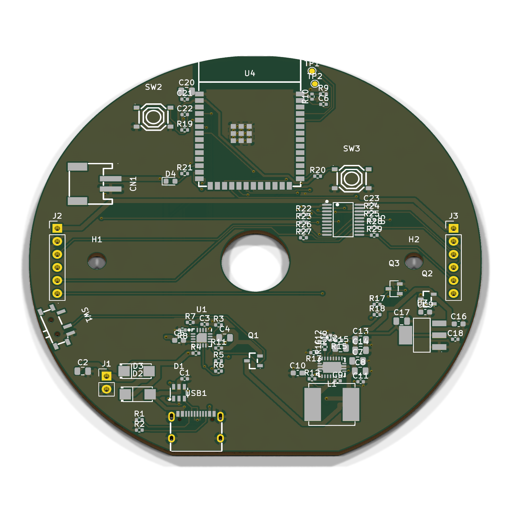
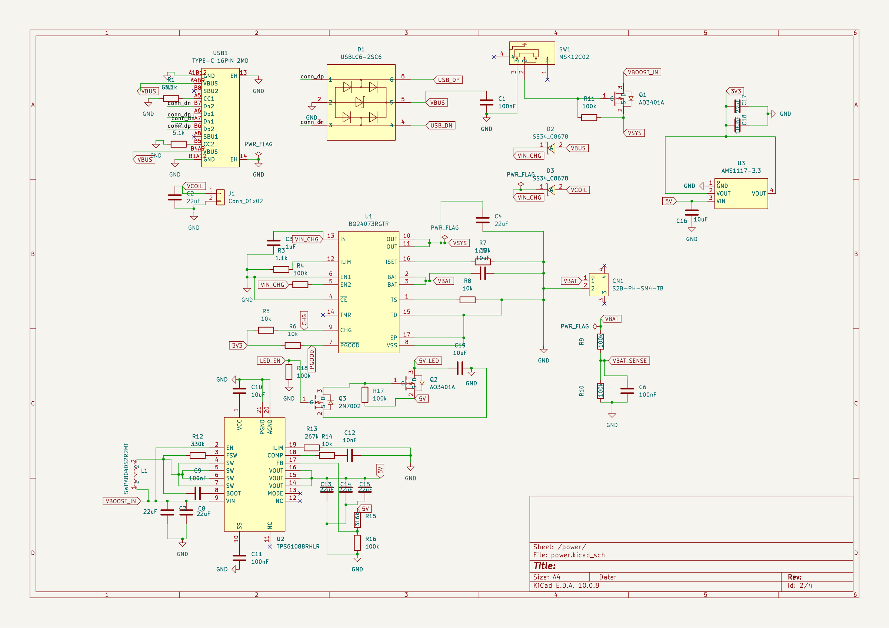
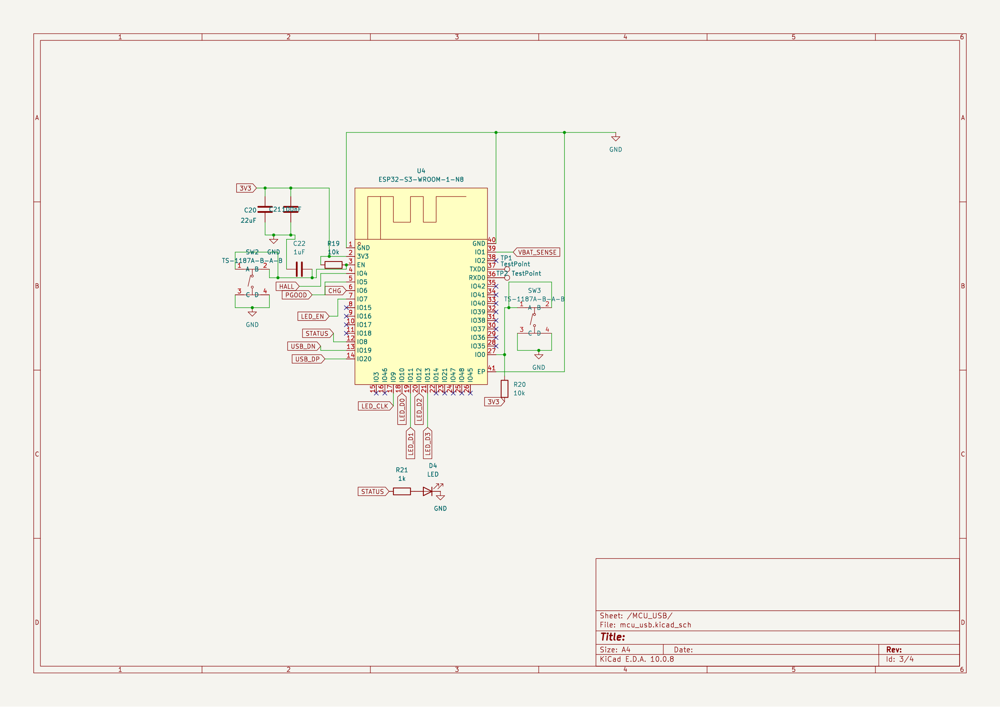
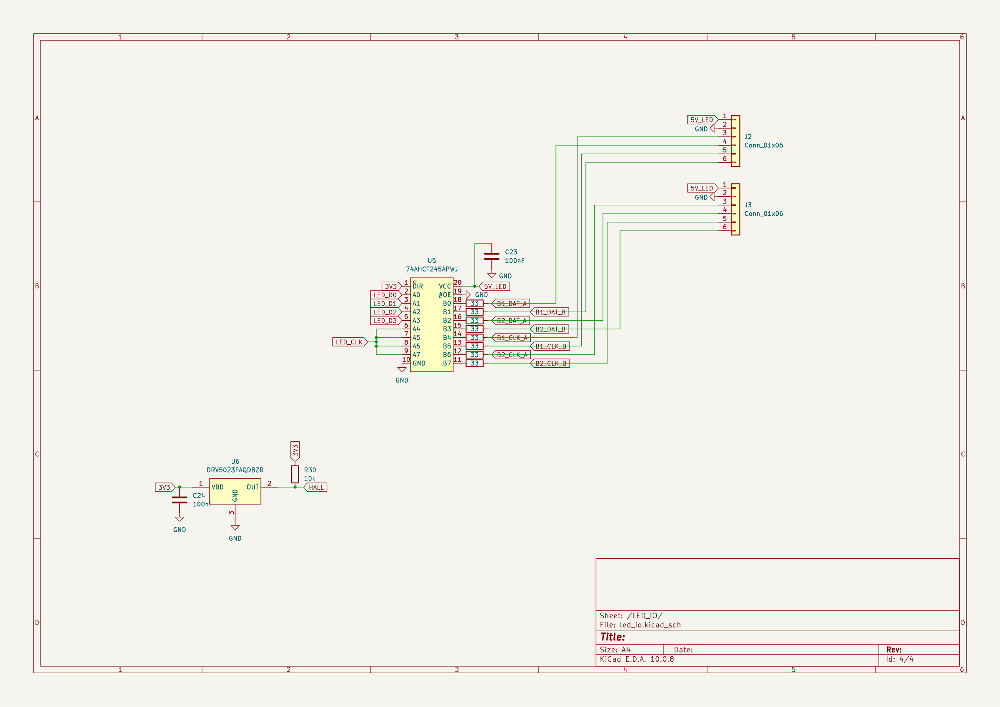

**$\color{violet}{\textsf{blade}}$**

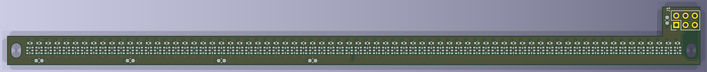
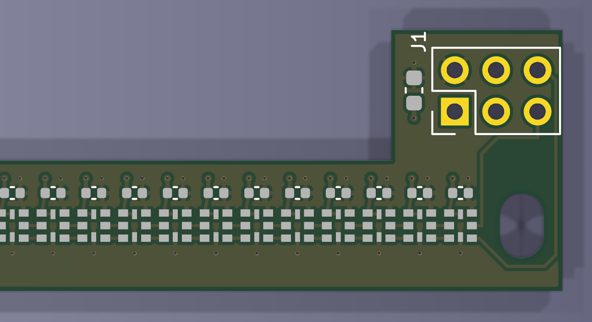
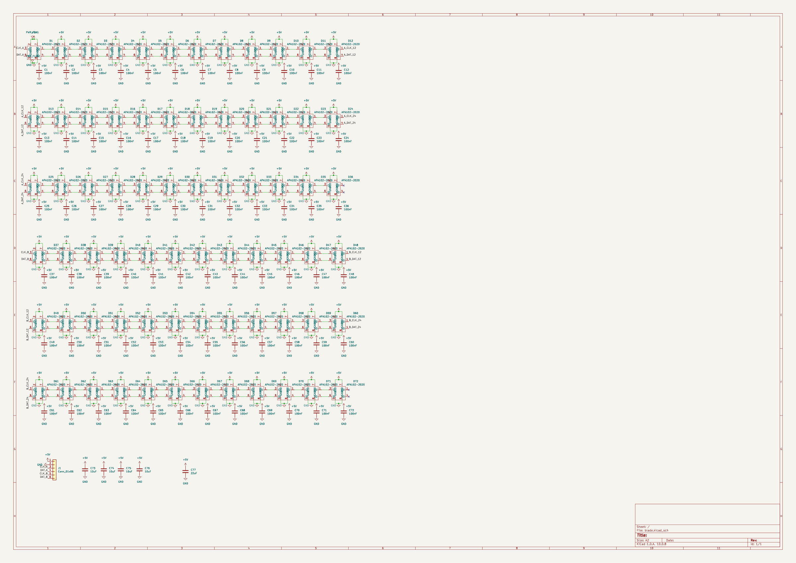

**$\color{violet}{\textsf{base}}$**

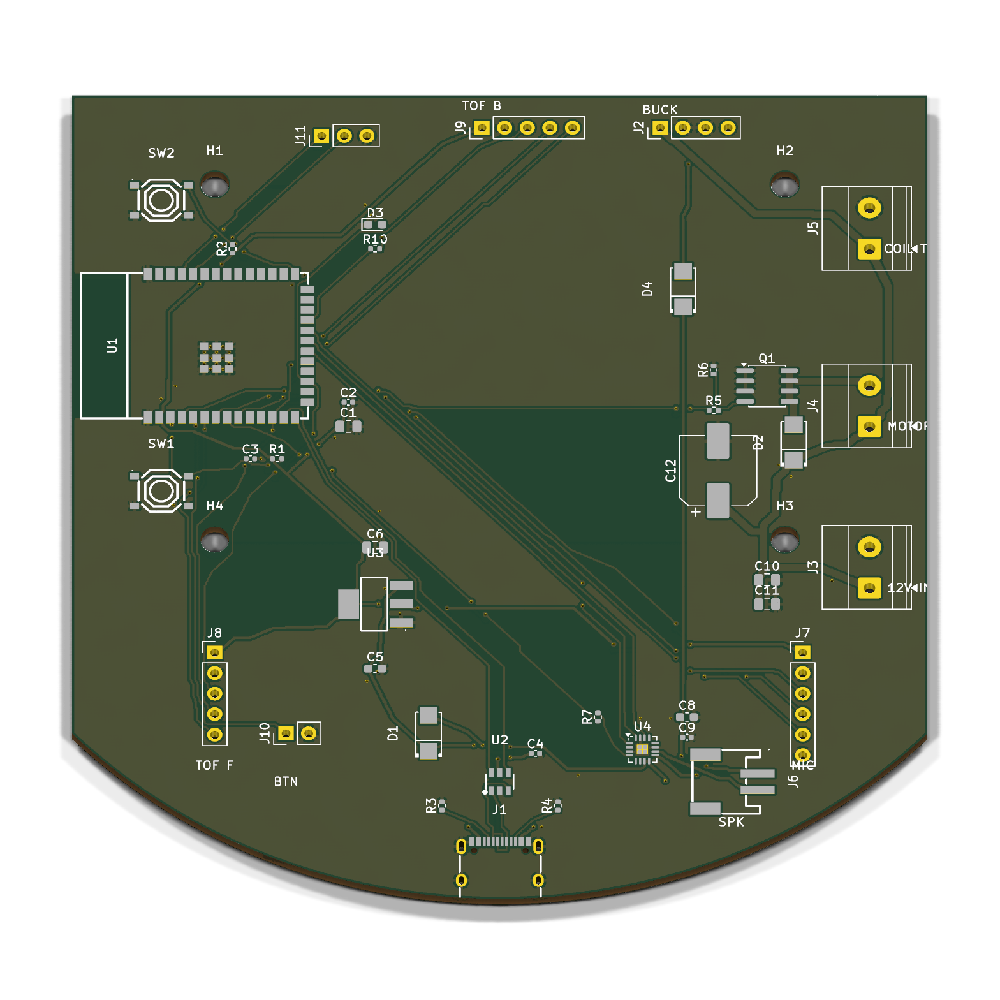
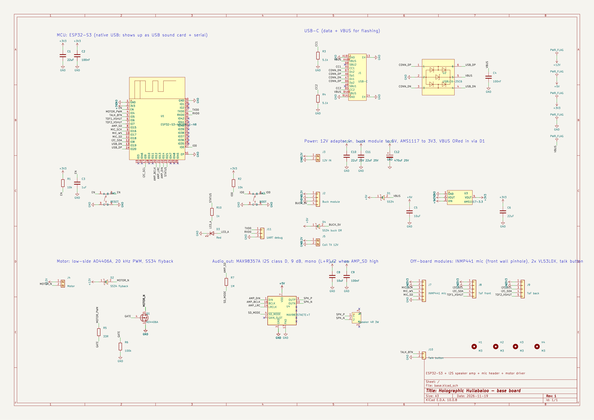

</details>

<details>
<summary>firmware</summary>

PlatformIO + Arduino, untested on hardware. Both projects compile.

| Folder | Runs on | Job |
| --- | --- | --- |
| `firmware/rotor` | Hub ESP32-S3 | Hall timing, column timer, LED DMA output, frame buffers, face layers, ESP-NOW receive, battery/power |
| `firmware/base` | Base ESP32-S3 | Motor soft start + PI speed loop, ToF sensors, talk button, USB serial link, ESP-NOW send |
| `firmware/shared` | Both | `packet.h`: state + status packets, magic/version/type/sequence header, CRC-8 |

Build: `cd firmware/base && pio run` (same for `firmware/rotor`).

Known gaps: the USB sound card on the base needs ESP-IDF / TinyUSB UAC (the Arduino core doesn't include USB audio), and the rotor needs a half-column timing offset where the LED chains meet at mid-blade.

**Base pin map (ESP32-S3)**

| GPIO | Function |
| --- | --- |
| IO4 | Motor PWM (AO4406A gate) |
| IO5 | Talk button |
| IO6 / IO7 | ToF front / back XSHUT |
| IO8 / IO9 | I2C SDA / SCL |
| IO12 / IO13 / IO14 | Amp BCLK / LRC / DIN |
| IO15 | Amp enable |
| IO16 / IO17 / IO18 | Mic SCK / WS / SD |
| IO21 | Status LED |
| IO19 / IO20 | USB D- / D+ |

**Rotor pin map (ESP32-S3)**

| GPIO | Function |
| --- | --- |
| IO1 | Battery voltage (ADC, 100k/100k divider) |
| IO4 | Hall sensor (falling edge capture) |
| IO5 / IO6 | Charger PGOOD / CHG |
| IO7 | LED power enable |
| IO8 | Status LED |
| IO9 | LED clock |
| IO10 to IO13 | LED data, 4 chains |
| IO19 / IO20 | USB D- / D+ |

</details>


<details>
<summary>bill of materials (BOM)</summary>

Full list with a link for every part: [`bom.csv`](bom.csv)

**Total: about $492.43 (Rs 46,292)** at Rs 94 = $1. JLC fab, assembly and shipping lines are estimates until the real quote. Aluminium bar and angle are bought locally in Mumbai; their links are price references.

| Group | Main parts |
| --- | --- |
| LEDs | 160 x APA102-2020 (Adafruit 3341, DigiKey India), 144 used + 16 spares |
| PCBs | Hub + base (JLC PCBA), 5 x 4-layer blades, stencil |
| Rotor electronics | ESP32-S3-WROOM-1-N8, BQ24073, TPS61088, AMS1117, 74AHCT245, DRV5023, passives |
| Base electronics | ESP32-S3-WROOM-1-N8, MAX98357A, AO4406A, INMP441, 40 mm speaker, 2 x VL53L0X, MP1584 buck, 470 uF cap |
| Power | Wireless coil pair, 2 ferrite sheets, 1S 1500 mAh LiPo, 12 V 3 A adapter |
| Mechanical | 775 motor, 5 mm flange coupling, 30 x 3 mm aluminium flat bar + 10 x 10 mm angle, 6 x 3 mm magnet, nylon standoffs, M2/M3 hardware, heat-set inserts |
| Enclosure | PETG, 1 mm polycarbonate sheet, primer + matte black paint |
| Tools | Hot air station (858D), solder paste (Sn42/Bi58), solder wire, hacksaw, file, pin vise drill, Allen keys, IPA, fume extractor |

</details>

<details>
<summary>how it evolved (non-darwinian)</summary>

```diff
@@ v0.1 . Nov 8 @@
- self-balancing jumping cube
+ spinning POV hologram
  because: i dont like physics

@@ v0.2 . Nov 8 @@
- flat LED fan, only readable from the front
+ cylinder you can walk around

@@ v0.3 . Nov 8 @@
- 48 rows of LEDs
+ 72 rows
  because: 48 pixels tall can't do facial expressions

@@ v0.4 . Nov 9 @@
- 1 blade + the battery as a counterweight
+ 2 blades
  because: 25 Hz flickers, and the battery was 2 to 3x too heavy to balance it

@@ v0.5 . Nov 9 @@
- battery only
+ wireless power coil, battery as backup
  because: no cable survives 1500 RPM

@@ v0.6 . Nov 9 @@
- 1 LED chain
+ 4 parallel chains
  because: one chain took the whole column time and vertical lines came out slanted

@@ v0.7 . Nov 9 @@
- Hall sensor at 15 mm, then 30 mm
+ Hall sensor at 35 mm
  because: it was sitting on top of the coil. twice

@@ v0.8 . Nov 10 @@
- JLC LEDs at 2.0 / 2.2 mm pitch
+ 160 Adafruit LEDs at 2.5 mm pitch, hand soldered
  because: every single listing had 0 stock, and the datasheet pads were too wide anyway

@@ v0.9 . Nov 11 @@
- BQ24072 charger
+ BQ24073 charger
  because: the 24072 output follows the battery, the 24073 holds a steady 4.4 V
+ first time ever opening KiCad

@@ v0.10 . Nov 17 @@
- 125 mm bars
+ 104 mm bars
  because: they would have hit the cover

@@ v0.11 . Nov 18 @@
- 2 layer blade PCB
+ 4 layer blade PCB
  because: 72 LEDs need solid power planes

@@ v0.12 . Nov 18 @@
- 240 mm cover, 15 mm standoffs
+ 252 mm cover, 13.5 mm standoffs
  because: the LiPo moved on top of the top bar, and the motor shaft barely reached the coupling

@@ v0.13 . Nov 19 @@
- the laptop's mic and speakers
+ speaker + mic in the base

@@ v0.14 . Nov 19 @@
- a dev board I already owned
+ a custom base PCB
  because: Fallen won't fund dev boards, and the BOM somehow had no base microcontroller or motor driver at all

@@ v0.15 . Nov 19 @@
- one-piece base
+ base with a removable floor
  because: the only way inside the old one was a 44 mm hole

@@ v1.0 . Nov 20 (submission day) @@
- 25 mm bars, M2 x 8 bolts
+ 30 mm bars, M2 x 6 bolts
  because: the bolts were trying to occupy the same space. physics said no
- hub USB-C on the round edge
+ hub USB-C on a new flat edge
  because: no plug could reach it
- buck straight onto the 5 V rail
+ diode on the buck + a 470 uF cap on 12 V
  because: USB and the buck could fight each other, and motor start dips the 12 V rail
- DC jack in the base wall
+ DC jack moved lower
  because: it was sitting on top of the speaker connector
```

</details>

<details>
<summary>ai usage</summary>

| Area | What I did | What AI (Claude) did |
| --- | --- | --- |
| Design decisions | Made every decision | Did calculations and scraped datasheets |
| Hub schematic | Drew all 3 sheets in KiCad | Gave a guide |
| Blade schematic | Drew it, made the LED symbol + footprint | Gave a guide|
| Hub layout | Placement, boost SW node / BOOT / VIN routing, GND pours, antenna keepout | Part of the placement, rest of the boost loop.|
| Blade layout | Picked the options (4-layer, wire tab, chain direction) | Built and routed the whole board by script (72 LEDs in a row) |
| Base PCB | Picked out solutions and proposed ideas and concepts| Made the layout and routing by script |
| CAD | All part studios and appearances | Made dimensioned sketches and carried out interference checks |
| Design review | Decided every fix (bar width, buck diode, 470 uF placement) | Cross-checked CAD, PCBs and BOM against each other. |
| Firmware | Reviewed it | Wrote the skeleton |
| Renders | Artistic direction | Blender scene and render scripts |
| BOM | Built the sheet, sourcing calls | Looked up parts and stock, filled rows |
| Journals | All of it | Nothing |
| This README | Wrote it | Section outline and number tables |

</details>

<details>
<summary>status and what's next?</summary>

| Part | Status |
| --- | --- |
| Calculations | Done ([`docs/calculations.md`](docs/calculations.md)) |
| Hub PCB | Designed, ERC/DRC clean, gerbers ready |
| Blade PCB | Designed, DRC clean, gerbers ready |
| Base PCB | Designed, ERC/DRC clean, gerbers ready |
| CAD | Done, 0 interferences, public on Onshape |
| Firmware | Skeleton, compiles, untested |
| Laptop app (STT, LLM, TTS) | Not started |
| Build | Waiting for design approval and parts |

Next: order PCBs and parts, build the base and spin a dummy rotor, bench-test the wireless coil, solder the blades, bring up the hub, get a static image stable, then the face, then the AI loop. Target: working and filmed by Dec 4.

</details>


<details>
<summary>LICENCE</summary>

MIT, see [LICENCE](LICENCE).

</details>
